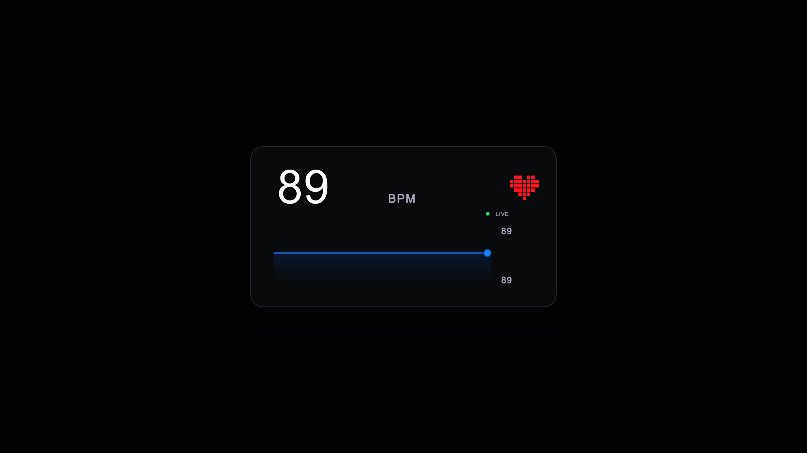
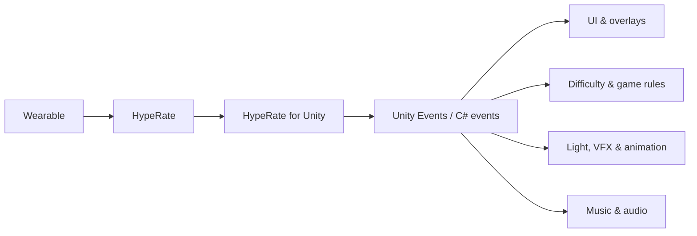

# HypeRate for Unity


Bring real-time heart rate into Unity without writing WebSocket, Phoenix channel,
heartbeat, or reconnect code. Use live BPM as UI, animation input, atmosphere,
audio control, or a real gameplay mechanic.



> **Version 2 preview:** the SDK has been rebuilt as a modern Unity package with
> Editor setup, automatic reconnects, Unity Events, typed C# events, simulation,
> connection status indicators, tests, and ready-to-import samples.

## What can you build with it?

Heart rate is just another real-time game signal. Displaying BPM is the simplest
use case, but the same value can drive almost any system in a scene:

| Area | Ideas |
| --- | --- |
| Dynamic difficulty | Increase enemy aggression, spawn rate, or encounter intensity as BPM rises. |
| Horror and suspense | React to fear with lighting, fog, camera effects, audio layers, or enemy behaviour. |
| Fitness and rhythm | Reward target heart-rate zones, synchronize movement, or alter music intensity. |
| Abilities and mechanics | Charge skills, open timing windows, modify cooldowns, or trigger events at thresholds. |
| Streaming and audience experiences | Show a live overlay or let biometric reactions influence a shared game session. |
| World feedback | Drive shader values, particles, animation speed, post-processing, or environmental colour. |



## Features

- Simple setup under **Tools > HypeRate > Setup**
- Live heart-rate events on Unity's main thread
- Inspector-friendly Unity Events and typed C# events
- Automatic Phoenix channel join, heartbeat, reconnect, and error handling
- Red/yellow/green connection indicators in the widget, setup window, and Inspector
- Blue simulation state that is clearly separated from real live data
- Resting, Workout, Intense, and Custom simulation profiles
- Responsive heart-rate widget with BPM history
- Package Manager samples and PlayMode tests
- Unity 2022.3+ package compatibility

## Install

In Unity, open **Window > Package Management > Package Manager**, click **+**,
choose **Install package from git URL**, and enter:

```text
https://github.com/HypeRate/HypeRate-Unity.git?path=/Packages/io.hyperate.unity
```

For production, pin a tagged version instead of following the moving default
branch:

```text
https://github.com/HypeRate/HypeRate-Unity.git?path=/Packages/io.hyperate.unity#v2.0.0
```

The package will also be available through the existing Unity Asset Store
listing when version 2 is released.

Prefer a file download? Every [GitHub Release](https://github.com/HypeRate/HypeRate-Unity/releases)
includes a classic `.unitypackage` and a Unity Package Manager `.tgz` archive.

## Five-minute setup

1. Open **Tools > HypeRate > Setup**.
2. Enter your HypeRate API token and Device ID.
3. Select **Save Settings**.
4. Select **Add HypeRate Client to Scene**.
5. Enter Play Mode.

The status dot changes from red to yellow to green as the client connects. The
Inspector shows the current BPM and exposes events without requiring code.

Editor test credentials are stored below `Assets/HypeRateGenerated/Editor`,
excluded from Git, and excluded from player builds. Configure production
credentials at runtime instead of embedding long-lived secrets in a build.

## Listen for heart-rate updates

```csharp
using HypeRate.SDK;
using UnityEngine;

public sealed class HeartRateLogger : MonoBehaviour
{
    [SerializeField] private HypeRateClient client;

    private void OnEnable() => client.HeartRateChanged += HandleHeartRate;
    private void OnDisable() => client.HeartRateChanged -= HandleHeartRate;

    private void HandleHeartRate(int bpm)
    {
        Debug.Log($"{bpm} BPM");
    }
}
```

## Turn BPM into gameplay

This example converts the current heart rate into a normalized `0..1` intensity
and uses it to drive light, music, and animation. The same value can be passed to
an enemy director, spawn system, shader, post-processing volume, or your own
game-state logic.

```csharp
using HypeRate.SDK;
using UnityEngine;

public sealed class HeartRateGameplayDriver : MonoBehaviour
{
    [SerializeField] private HypeRateClient client;
    [SerializeField] private Light sceneLight;
    [SerializeField] private AudioSource music;
    [SerializeField] private Animator characterAnimator;
    [SerializeField] private int restingBpm = 60;
    [SerializeField] private int intenseBpm = 160;

    private void OnEnable() => client.HeartRateChanged += ApplyHeartRate;
    private void OnDisable() => client.HeartRateChanged -= ApplyHeartRate;

    private void ApplyHeartRate(int bpm)
    {
        float intensity = Mathf.InverseLerp(restingBpm, intenseBpm, bpm);

        sceneLight.intensity = Mathf.Lerp(1f, 8f, intensity);
        music.pitch = Mathf.Lerp(0.9f, 1.2f, intensity);
        characterAnimator.SetFloat("HeartRateIntensity", intensity);
    }
}
```

For a no-code workflow, connect **On Heart Rate Changed** in the Inspector to a
public method that accepts an `int`.

## Try it without a wearable

Import the **Heart Rate Widget** sample from Package Manager and enter Play Mode.
With saved credentials it uses real live data; without credentials it starts the
Workout simulator automatically. Live and simulated values travel through the
same `HeartRateChanged` event, so game logic does not need separate code paths.

## Requirements

- Unity 2022.3 or newer
- HypeRate API access and a WebSocket API token
- The Device/Session ID shown in HypeRate

API availability and commercial terms depend on the project. See the
[HypeRate API page](https://hyperate.io/api) for current details.

## Documentation

- [Getting started](Packages/io.hyperate.unity/Documentation~/getting-started.md)
- [Migration from 1.x](Packages/io.hyperate.unity/Documentation~/migration-from-1.x.md)
- [Changelog](Packages/io.hyperate.unity/CHANGELOG.md)
- [Release process](RELEASING.md)

The repository includes a Unity 6.6 demo project. The package itself keeps Unity
2022.3 as its minimum supported version.

## Privacy and safety

Heart-rate data is sensitive biometric information. Ask for informed consent,
collect only what the experience needs, and avoid presenting game behaviour as
medical advice or diagnosis. Do not ship long-lived API credentials in source
code, scenes, or client builds.
